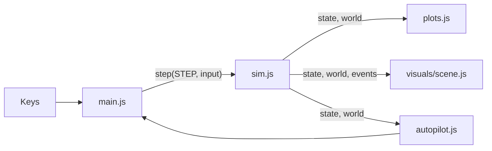

# Lander

The `/simulator/` page: a lunar lander you fly by hand or hand to an
autopilot, rendered in 3D with three.js, with time-series plots of each round.
Each module's header comment covers its own details; this file covers how
they fit together and the rules that span them.

## How a frame runs



`main.js` owns the loop. Each frame it runs as many fixed `STEP`s of the sim
as the frame's time covers. Each step takes its input from either the keys or
`autopilot.update(STEP)`, and `plots.record(STEP)` samples after it. Then
`visuals.update(dt)` and `render()` run once at the frame's own dt. Visuals
drain `sim.events` (`reset`, `landed`, `missed`, `crashed`) to rebuild the
world or start an explosion.

| Module | Role |
|---|---|
| `sim.js` | The game: world generation, state, physics, contact rules. No DOM, no rendering. |
| `rng.js` | Seeded PRNG, shared by the sim and the visuals. |
| `autopilot.js` | Cascaded PID pilot; also exports `createPid`. |
| `plots.js` | Canvas 2D time series of a round. |
| `main.js` | Page entry: input, pilot and seed controls, the loop, the HUD. |
| `visuals/` | three.js view: `scene.js` wires up `view.js` (camera), `terrain.js`, `sky.js`, `lander.js`, `pad.js`, `effects.js`, `noise.js`. |

## Rules that span modules

- **Gameplay lives only in `sim.js`.** Visuals and plots read the sim and
  never write to it. Anything purely visual (particles, debris, scenery off
  the ground line) belongs in `visuals/`.
- **Reproducible rounds.** A round's starting conditions all come from its
  seed through `rng.js`: ground, pad, start position and drift. The sim only
  ever advances in fixed `STEP`s. Same seed and same pilot give a
  bit-identical round, whatever the frame rate. The sim and autopilots must
  never use `Math.random` or the frame dt. Visuals may: the scenery is
  seeded, the effects aren't.
- **The view is locked to the play plane.** The camera looks straight at
  z = 0, and the plane maps onto the canvas exactly as the original 2D game
  did. The 3D landscape is built around the sim's 1D ground line and keeps
  that line visible; see `visuals/terrain.js`.

## Coordinates

| Where | x | y | angle | units |
|---|---|---|---|---|
| Sim (`sim.js`) | + right | + **down** | + clockwise | px, s, rad |
| 3D world (`visuals/`) | + right | + up | (lander `rotation.z = -angle`) | 1 unit = 1 px; plane at z = 0, + z toward the camera |
| Plots, HUD | + right | + up | + clockwise | px, s, degrees |

## Adding an autopilot

An autopilot is anything with:

- `update(dt)` → `{ left, right, up }`: the same booleans the keys produce,
  called once per sim step, reading `sim.state` and `sim.world`;
- `reset()`: forget controller state; called on restart and on pilot change.

Build it from `createSim`'s object, as `createAutopilot(sim)` does. Add a
button in `#sim-pilot` (`src/simulator/index.njk`) and the matching branch in
`main.js`'s loop.

To compare pilots on many environments without the browser, the sim and
autopilot modules run in plain Node from the repo:

```js
// pilot-test.mjs. Run: docker run --rm -v "$PWD":/work -w /work node:20-alpine node pilot-test.mjs
// (Node warns about the module type; harmless.)
import { createSim, STEP } from "./src/js/lander/sim.js";
import { createAutopilot } from "./src/js/lander/autopilot.js";

const tally = {};
for (let seed = 0; seed < 1000; seed++) {
  const sim = createSim({ width: 640, height: 400, seed });
  const pilot = createAutopilot(sim);
  for (let n = 0; sim.state.status === "flying" && n < 120 * 120; n++) sim.step(STEP, pilot.update(STEP));
  tally[sim.state.status] = (tally[sim.state.status] || 0) + 1;
}
console.log(tally);
```

The page's 640 × 400 canvas is the plane's size, so use those dimensions to
match the browser.
