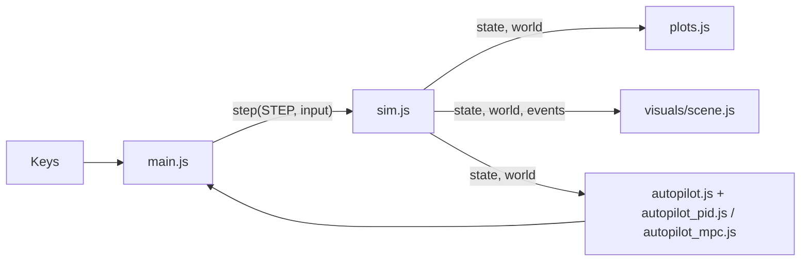

# Lander

The `/simulator/` page: a lunar lander you fly by hand or hand to an
autopilot (PID, or an acados MPC compiled to WebAssembly), rendered in 3D with
three.js, with time-series plots of each round. Each module's header comment
covers its own details; this file covers how they fit together and the rules
that span them.

## How a frame runs



`main.js` owns the loop. Each frame it runs as many fixed `STEP`s of the sim
as the frame's time covers. Each step takes its input from the keys or the
selected autopilot's `update(STEP)`, and `plots.record(STEP)` samples after
it. Then `visuals.update(dt)` and `render()` run once at the frame's own dt.
Visuals drain `sim.events` (`reset`, `landed`, `missed`, `crashed`) to rebuild
the world or start an explosion.

| Module | Role |
|---|---|
| `sim.js` | The game: world generation, state, physics, contact rules. No DOM, no rendering. |
| `rng.js` | Seeded PRNG, shared by the sim and the visuals. |
| `autopilot.js` | What all autopilots share: wraps a controller into a pilot (control rate, on/off modulation of its commands, the keys' interface), plus the common landing approach and terrain query. |
| `autopilot_pid.js` | PID controller: cascaded loops every sim step; also exports `createPid`. |
| `autopilot_mpc.js` | MPC controller: loads `mpc/lander_mpc.{js,wasm}`, sets targets and terrain floors, re-plans at 100 Hz (every 2 sim steps). |
| `mpc/` | **Generated** by `make mpc` from `tools/lander-mpc/` (see [its README](../../../tools/lander-mpc/README.md)). Don't edit. |
| `plots.js` | Canvas 2D time series of a round. |
| `main.js` | Page entry: input, pilot and seed controls, the loop, the HUD. |
| `visuals/` | three.js view: `scene.js` wires up `view.js` (camera), `terrain.js`, `sky.js`, `lander.js`, `pad.js`, `effects.js`, `noise.js`. |

## Rules that span modules

- **Gameplay lives only in `sim.js`.** Visuals and plots read the sim and
  never write to it. Anything purely visual (particles, debris, scenery off
  the ground line) belongs in `visuals/`.
- **Reproducible rounds.** A round's starting conditions all come from its
  seed through `rng.js`: ground, pad, start position and drift. The sim only
  ever advances in fixed `STEP`s. Same seed and same pilot give a
  bit-identical round, whatever the frame rate. The sim and autopilots must
  never use `Math.random` or the frame dt. Visuals may: the scenery is
  seeded, the effects aren't. The MPC is deterministic too: wasm floating
  point is, and `reset()` clears its warm start.
- **The MPC's model is the sim.** `tools/lander-mpc/ocp.py` reads `GRAVITY`,
  `MAIN_THRUST` and `RCS_ACCEL` from `sim.js` when it generates the solver.
  Change any of them, or the dynamics in `sim.js`, and re-run `make mpc`
  (and update the model in `ocp.py` if the dynamics changed).
  `test/mpc.test.mjs` fails if they've drifted apart.
- **The view is locked to the play plane.** The camera looks straight at
  z = 0, and the plane maps onto the canvas exactly as the original 2D game
  did. The 3D landscape is built around the sim's 1D ground line and keeps
  that line visible; see `visuals/terrain.js`. `test/terrain.test.mjs` checks
  both: the landscape at z = 0 is the sim's ground, and nothing in front
  rises above it on screen.

## Coordinates

| Where | x | y | angle | units |
|---|---|---|---|---|
| Sim (`sim.js`), MPC model | + right | + **down** | + clockwise | px, s, rad |
| 3D world (`visuals/`) | + right | + up | (lander `rotation.z = -angle`) | 1 unit = 1 px; plane at z = 0, + z toward the camera |
| Plots, HUD | + right | + up | + clockwise | px, s, degrees |

## Adding an autopilot

To the page, an autopilot is anything with the keys' interface:

- `update(dt)` → `{ left, right, up }`, called once per sim step, reading
  `sim.state` and `sim.world`;
- `reset()`, called on restart and on pilot change;
- `telemetry`, an object of whatever it wants the HUD to show.

You don't write that part. Write a controller,
`{ rate, reset(), command(dt) → { throttle, torque }, telemetry }`, and
wrap it with `createAutopilot(sim, controller)` from `autopilot.js`, as
`autopilot_pid.js` and `autopilot_mpc.js` do. `rate` is in Hz and must be a
whole number of sim steps; `throttle` is the main engine's duty in [0, 1],
`torque` the RCS's in [-1, 1] (+ clockwise). The wrapper holds each command
until the next tick and turns duties into on/off pulses. `createApproach`
and `highestGround` there are available if the new controller wants the same
landing approach or terrain queries.

Then add a button in `#sim-pilot` (`src/simulator/index.njk`), an entry in
`main.js`'s `pilots` and `MODE_LABELS`, and its HUD line in `updateHud`. Give
it tests like `test/autopilot.test.mjs` (PID) or `test/mpc.test.mjs` (MPC):
at least that rounds with it are reproducible.

To compare pilots on many environments without the browser, the sim and
autopilot modules run in plain Node from the repo, the MPC's wasm included:

```js
// pilot-test.mjs. Run: docker run --rm -v "$PWD":/work -w /work node:20-alpine node pilot-test.mjs
// (Node warns about the module type; harmless.)
import { createSim, STEP } from "./src/js/lander/sim.js";
import { createPidAutopilot } from "./src/js/lander/autopilot_pid.js";
import { loadMpc, createMpcAutopilot } from "./src/js/lander/autopilot_mpc.js";

const mpc = await loadMpc();
const pilots = { pid: (sim) => createPidAutopilot(sim), mpc: (sim) => createMpcAutopilot(sim, mpc) };
for (const [name, create] of Object.entries(pilots)) {
  const tally = {};
  for (let seed = 0; seed < 200; seed++) {
    const sim = createSim({ width: 640, height: 400, seed });
    const pilot = create(sim);
    pilot.reset();
    for (let n = 0; sim.state.status === "flying" && n * STEP < 120; n++) sim.step(STEP, pilot.update(STEP));
    tally[sim.state.status] = (tally[sim.state.status] || 0) + 1;
  }
  console.log(name, tally);
}
```

The page's 640 × 400 canvas is the plane's size, so use those dimensions to
match the browser.
